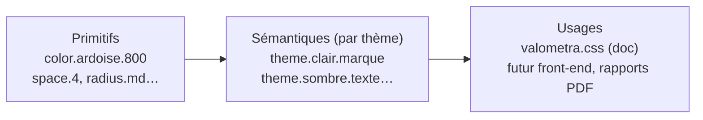

# Design tokens

Un *design token* est une décision visuelle nommée (« couleur du texte »,
« espacement 4 ») stockée comme donnée. Valometra les décrit au format
**W3C Design Tokens** dans un seul fichier, d'où tout le reste est généré.

## Trois niveaux



| Niveau | Où | Exemple | Règle |
|---|---|---|---|
| **Primitifs** | `color`, `font`, `space`, `radius`, `shadow`, `duration`, `easing` | `--vm-color-cuivre-500` | Palette brute ; jamais utilisée directement dans un composant si un token sémantique existe |
| **Sémantiques** | `theme.clair`, `theme.sombre` | `--vm-action` | Alias vers un primitif ; mêmes clés dans chaque thème |
| **Usages** | feuilles de style | `--md-primary-fg-color: var(--vm-marque)` | Ne contiennent aucune valeur en dur |

Changer `theme.clair.action` modifie tous les boutons principaux ;
changer `color.cuivre.500` modifie tout ce qui y fait référence.

## Génération

Commande : `uv run python design/build_tokens.py`

| Étape | Entrée | Traitement | Sortie |
|---|---|---|---|
| 1. Lecture | `design/tokens/valometra.tokens.json` | Parcours de l'arbre ; le `$type` d'un groupe s'applique à ses enfants | liste (chemin, type, valeur) |
| 2. CSS primitifs | tokens hors `theme` | nom `--vm-<chemin>` ; `dimension`/`duration` → `16px`, `120ms` ; `fontFamily` → liste CSS ; `shadow` → `x y flou étalement couleur` ; `cubicBezier` → `cubic-bezier()` | bloc `:root` de `docs/assets/stylesheets/valometra-tokens.css` |
| 3. CSS sémantiques | `theme.clair`, `theme.sombre` | nom `--vm-<clé>` ; alias `{color.x.y}` → `var(--vm-color-x-y)` | un bloc par thème, activé par `[data-md-color-scheme]` (site) ou `[data-vm-theme]` (tout autre support) |
| 4. Référence | tous les tokens | alias résolus jusqu'à la couleur finale ; contraste WCAG calculé | `docs/08_design/reference.md` |
| 5. Logos | `design/logo/*.svg` | copie à l'identique | `docs/assets/images/*.svg` |

Seuls les fichiers dont le contenu change sont réécrits. `--check`
n'écrit rien et sort en erreur (code 1) si une sortie est périmée.

!!! danger "Fichiers générés"
    `valometra-tokens.css`, `reference.md` et `docs/assets/images/*.svg`
    portent la mention « FICHIER GÉNÉRÉ » ou sont des copies : toute
    modification à la main est écrasée et fait échouer les tests.

## Contrôles automatiques

`tests/unit/test_design_tokens.py` (lancé par `uv run pytest` et la CI) :

| Test | Garantie |
|---|---|
| `test_sorties_generees_a_jour` | CSS, page de référence et logos correspondent aux tokens |
| `test_alias_resolus_vers_des_couleurs` | chaque token sémantique aboutit à une couleur `#RRGGBB` |
| `test_themes_definissent_les_memes_tokens` | clair et sombre ont exactement les mêmes clés |
| `test_contrastes_wcag_aa` | chaque paire texte/fond de `CONTRAST_PAIRS` (textes, liens, boutons, couleurs d'état) atteint 4,5:1 dans chaque thème |
| `test_contrast_ratio_valeurs_de_reference` | le calcul de contraste donne 21:1 (noir/blanc) et 1:1 |

## Utiliser les tokens

**Dans le site de documentation** : déjà fait, via `extra_css` dans
`zensical.toml`. Pour un nouvel élément, écrire du CSS dans
`docs/assets/stylesheets/valometra.css` en n'utilisant que des
variables `--vm-*`.

**Dans une autre interface web** (futur front-end, rapport HTML/PDF) :
inclure `valometra-tokens.css`, puis

```css
.carte-resultat {
  background: var(--vm-marque);
  color: var(--vm-sur-marque);
  border-radius: var(--vm-radius-lg);
  padding: var(--vm-space-8);
  font-family: var(--vm-font-family-body);
}
```

Thème sombre hors du site : `<html data-vm-theme="sombre">`.

**Dans du Python** (graphiques matplotlib, rapports) : lire le JSON et
résoudre les alias avec la fonction `resolve` de `design/build_tokens.py`,
par exemple `resolve(tokens, "color.dataviz.categorie-1")`.
